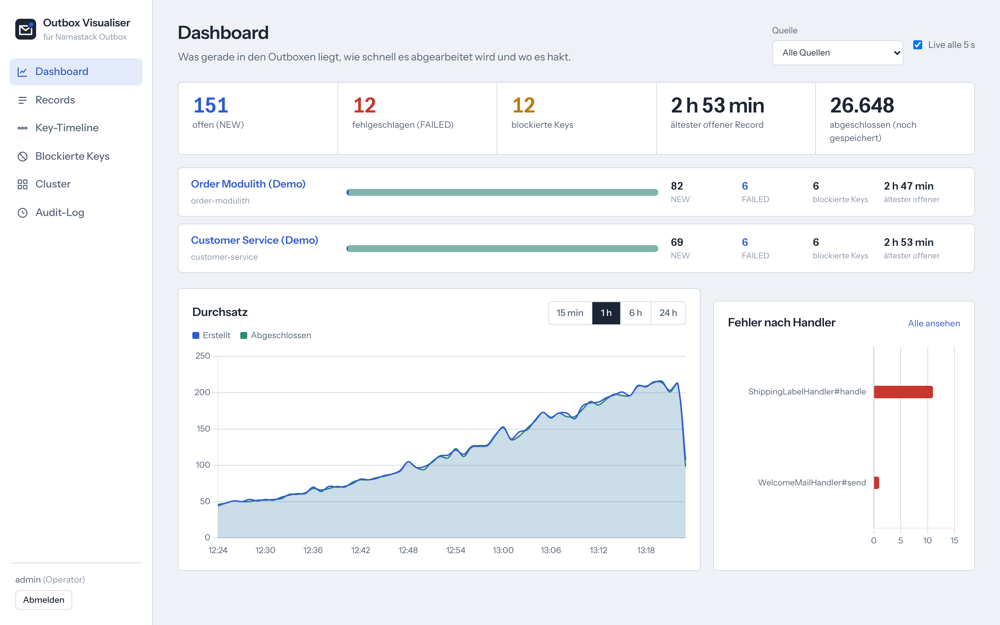
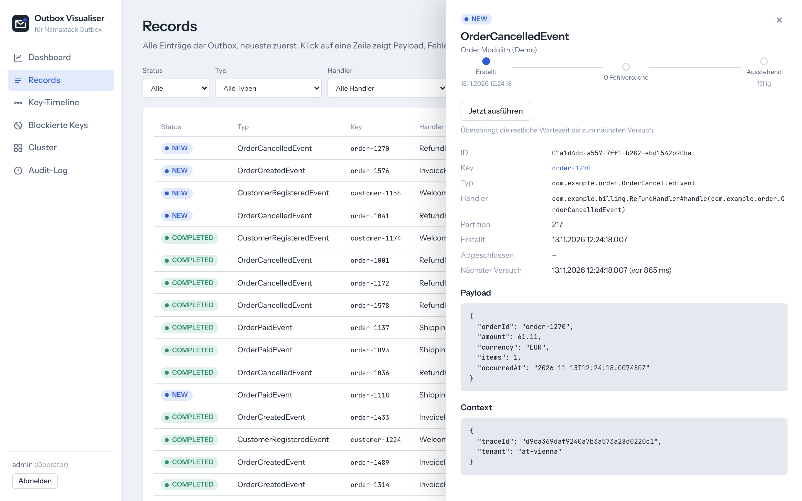
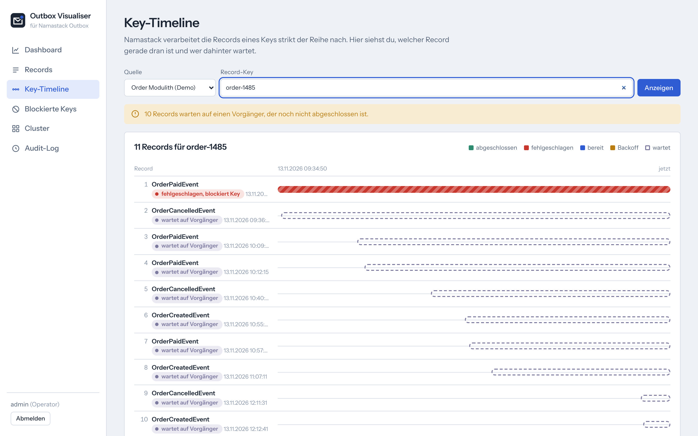
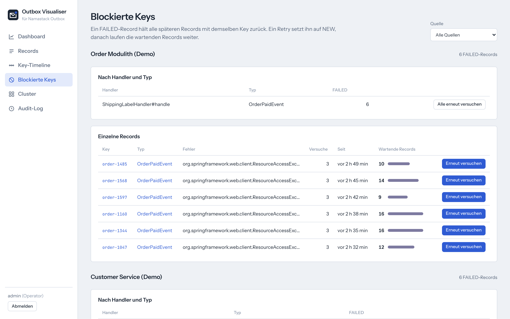
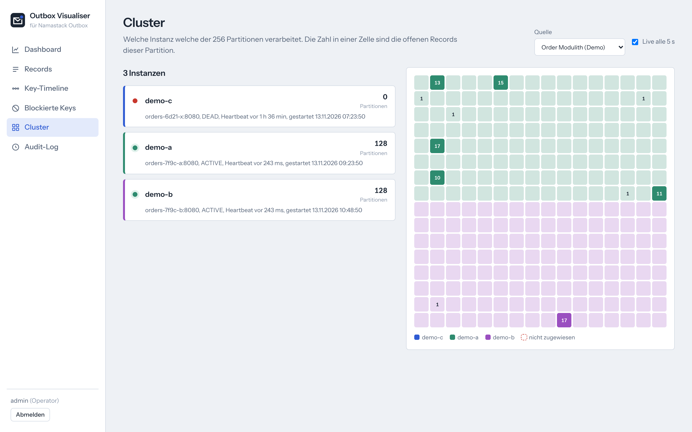

<p align="center"></p>

<h1 align="center">Namastack Outbox Visualiser</h1>

Web UI for the tables of [Namastack Outbox](https://github.com/namastack/namastack-outbox) (JDBC module, tested against the v1.11 schema).
It shows what is sitting in the outboxes of one or more services and lets you reprocess events.

- **Dashboard**: open, failed and completed records per service, oldest open record, throughput (created vs. completed) and failures per handler, live every 5 s
- **Records**: filterable list with a detail view (payload, context, failure, retry state)
- **Key timeline**: all records of a `record_key` on a timeline, marking which records are waiting for a predecessor
- **Blocked keys**: FAILED records and the number of records queued behind them
- **Cluster**: Namastack instances with their heartbeat and the assignment of the 256 partitions
- **Audit log**: who performed which action and when



## Screenshots

| | |
|---|---|
| **Records** with detail drawer<br> | **Key timeline** of a blocked key<br> |
| **Blocked keys**<br> | **Cluster** instances and partitions<br> |

## Actions

| Action | Applies to | What happens in `outbox_record` |
|---|---|---|
| Retry | FAILED | `status=NEW, failure_count=0, failure_reason=NULL, next_retry_at=now` |
| Run now | NEW in backoff | `next_retry_at=now` |
| Replay | COMPLETED | new row (UUIDv7) with the same key, type, payload, context, handler and partition, `status=NEW`, `created_at=now` |
| Retry all | all FAILED records of a handler/type | like "Retry", as a single UPDATE |

Every action is a single statement with a status condition (`WHERE id = ? AND status = 'FAILED'` etc.). This makes it atomic, and a double click or a Namastack instance running in parallel does no harm.

Important to understand: Namastack only processes a record once all earlier records **of the same key** are completed. A FAILED record therefore blocks its key. Only a retry releases the waiting records.

A replay only works as long as the COMPLETED record still exists, i.e. as long as Namastack has not deleted it during cleanup.

## Quick start with demo data

Requirement: JDK 25 (Gradle downloads it via the toolchain if it is missing).

```bash
./gradlew bootRun --args='--spring.profiles.active=demo'
```

Then open <http://localhost:8090> and log in with `admin` / `admin` (operator) or `viewer` / `viewer` (read-only).
The demo profile creates two in-memory H2 databases with the original Namastack schema and continuously simulates events, retries, failures and instances in them.

## Docker

The image is published as [`asgreflexx/namastack-visualiser`](https://hub.docker.com/r/asgreflexx/namastack-visualiser) for `linux/amd64` and `linux/arm64`.

Demo:

```bash
docker run --rm -p 8090:8090 -e SPRING_PROFILES_ACTIVE=demo asgreflexx/namastack-visualiser
```

With your own configuration, mount an `application.yml` (see below) into `/config`:

```bash
docker run -d -p 8090:8090 \
  -v ./application.yml:/config/application.yml:ro \
  -e ORDERS_DB_PASSWORD=... \
  asgreflexx/namastack-visualiser
```

Or configure everything via environment variables:

```bash
docker run -d -p 8090:8090 \
  -e VISUALISER_SOURCES_0_ID=order-modulith \
  -e VISUALISER_SOURCES_0_URL=jdbc:mysql://db:3306/orders \
  -e VISUALISER_SOURCES_0_USERNAME=outbox_visualiser \
  -e VISUALISER_SOURCES_0_PASSWORD=... \
  -e VISUALISER_USERS_0_USERNAME=ops \
  -e 'VISUALISER_USERS_0_PASSWORD={bcrypt}$2a$10$...' \
  -e VISUALISER_USERS_0_ROLE=OPERATOR \
  asgreflexx/namastack-visualiser
```

The container runs as a non-root user and listens on port 8090. `/actuator/health` is reachable without login and can be used for liveness/readiness probes.

## Connecting your own services

Add one entry per service database under `visualiser.sources` in `application.yml` (or via environment variables):

```yaml
visualiser:
  sources:
    - id: order-modulith            # appears in URLs, only a-z, 0-9 and -
      name: Order Modulith
      url: jdbc:mysql://db:3306/orders
      username: outbox_visualiser
      password: ${ORDERS_DB_PASSWORD}
      schema:                       # like namastack.outbox.jdbc.schema-name
      table-prefix: ""              # like namastack.outbox.jdbc.table-prefix
      tables:                       # only needed for custom table names
        record: outbox_record
        instance: outbox_instance
        partition: outbox_partition
      read-only: false              # true disables all actions for this source
    - id: payment-service
      name: Payment Service
      url: jdbc:sqlserver://db:1433;databaseName=payments;encrypt=false
      username: outbox_visualiser
      password: ${PAYMENTS_DB_PASSWORD}
  users:
    - username: ops
      password: "{bcrypt}$2a$10$..."
      role: OPERATOR
    - username: dev
      password: "{bcrypt}$2a$10$..."
      role: VIEWER
```

Supported databases: MySQL, MariaDB, Oracle, SQL Server and H2. Drivers for all five are included.
An unreachable database does not prevent startup; it is shown in red on the dashboard.
If no users are configured, an operator `admin` with a random password is created at startup and written to the log.

### Required database privileges

- `SELECT` on `outbox_record`, `outbox_instance`, `outbox_partition`
- additionally `UPDATE` and `INSERT` on `outbox_record` if the source is not `read-only`

## Development

```bash
./gradlew test              # unit and web tests against H2
./gradlew integrationTest   # Testcontainers against MySQL, MariaDB, Oracle Free and SQL Server (requires Docker)
./gradlew bootJar           # build/libs/namastack-visualiser-*.jar
docker build -t namastack-visualiser .
```

The integration tests load the original Namastack schema script of each database (`src/integrationTest/resources/schema`).

### Releasing

Pushing a tag `vX.Y.Z` runs `.github/workflows/release.yml`: it runs the tests, builds the image for amd64 and arm64 and pushes it to Docker Hub as `X.Y.Z`, `X.Y` and `latest`.
The repository needs the Actions secrets `DOCKERHUB_USERNAME` and `DOCKERHUB_TOKEN` (a Docker Hub access token with read & write scope).

```bash
git tag v0.1.0 && git push origin v0.1.0
```

### Structure

| Package | Contents |
|---|---|
| `source` | Configuration, one connection pool per source, dialect detection (only for pagination), table names |
| `record` | Read access to `outbox_record` |
| `cluster` | Instances and partitions |
| `stats` | Metrics and throughput for the dashboard |
| `action` | Retry, run now, replay, bulk retry and the audit log |
| `web` | Controllers, Thymeleaf + htmx, Chart.js |
| `demo` | Data generator for the `demo` profile |

Like Namastack itself, timestamps are bound and read as `java.sql.Timestamp`. The visualiser and the services should therefore run in the same JVM time zone if the database uses columns without a time zone (MySQL/MariaDB `TIMESTAMP`, SQL Server `DATETIME2`).
